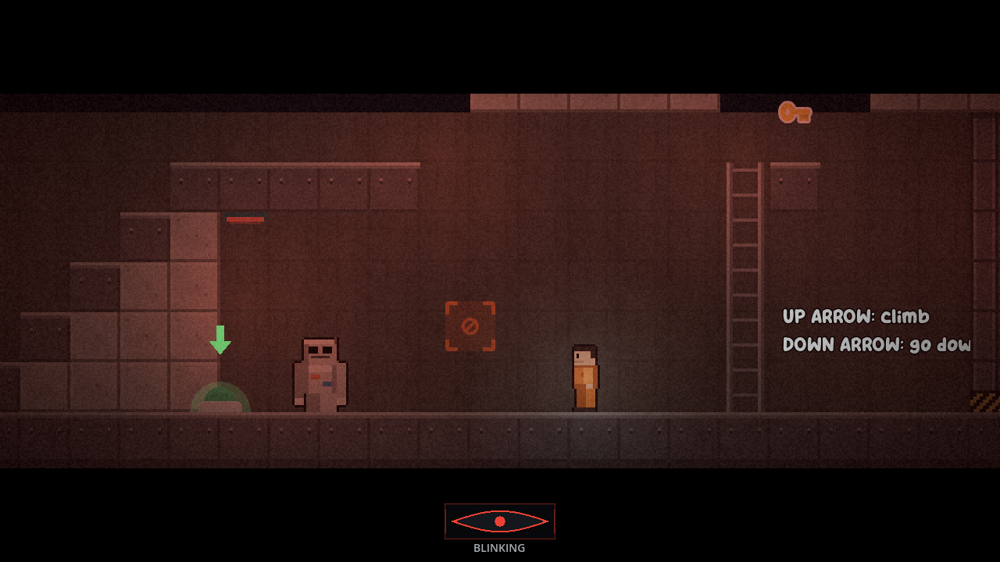
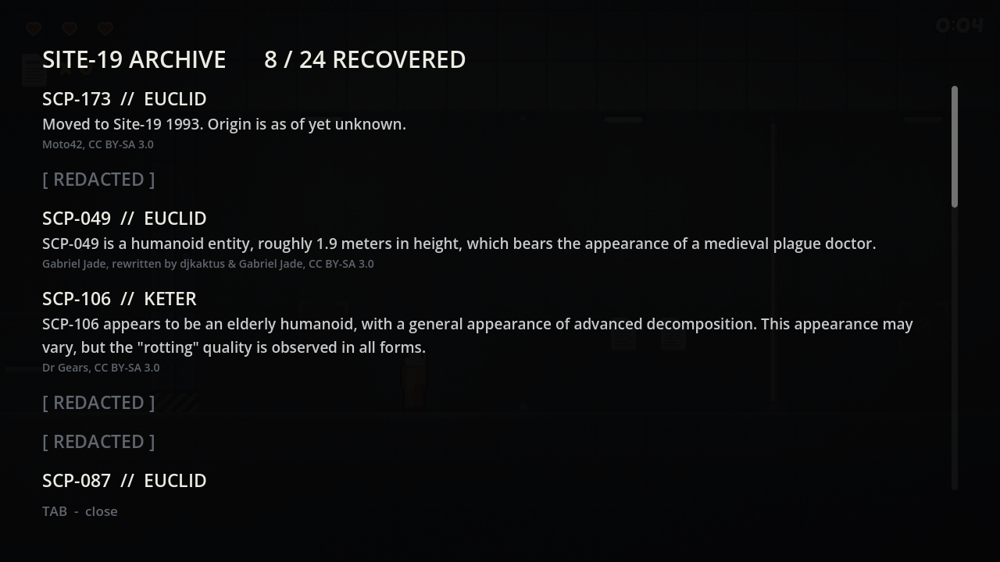
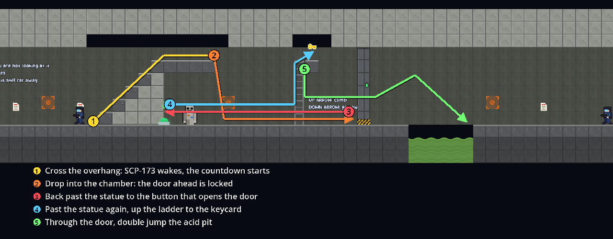
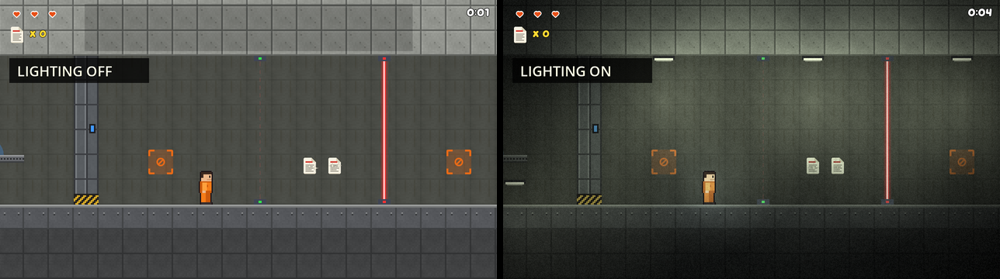

# Class-D Breakout

A 2D horror platformer set in the SCP Foundation universe, made in Godot 4.7
with GDScript.

You play Class-D subject D-9341. Site-19 is in containment breach, your cell
lock has failed, and the way out leads past the guards, the lasers and
SCP-173, a statue that only moves when nobody is looking at it.

I built it on my own for the *Introduction to Video Game Making* course at
Leiden University (2026). A run takes about three minutes.

## Highlights

- **A horror mechanic in a side-scroller.** SCP-173 freezes while you face it,
  but a blink meter forces your eyes shut every five seconds and the statue
  lunges while they are closed.
- **A reworked player controller.** Acceleration, coyote time, jump buffering,
  variable jump height and faster falling, each value tuned to the level (see
  [Player movement](#player-movement)).
- **Nine reusable building blocks** (platforms, lasers, doors, ladders,
  guards and more), each its own scene with its settings exposed in the
  Inspector, so the level is built without writing code per object.
- **Guard AI** as a state machine with raycast line of sight and ledge
  detection.
- **An in-game archive** of 24 real SCP Wiki entries, unlocked by collecting
  documents.
- **Lighting placed from the tilemap** and a screen shader for the facility
  look, plus a Python tool that repaints the tilesheet.
- **Iterated through playtesting.** The statue section went through several
  versions before it worked (see [Testing and iteration](#testing-and-iteration)).

## Features

- Every document you pick up is a real SCP Foundation file, and the ones you
  have found can be read in a pause screen. Entries you are still missing show
  as `[ REDACTED ]`, so the archive also tells you how much is left to find.
- The end screen ranks the run from S to D on a score out of 100: 50 for
  documents recovered, 30 for staying alive (minus 5 per death) and 20 for
  speed (full marks under three minutes, none after eight).
- Waking SCP-173 starts a lockdown countdown. The keycard, the way back past
  the statue and the run to the exit gate all happen on that clock. Dying does
  not reset it, and if it runs out the run ends on its own screen.
- Guards run a state machine with patrol, alert, stunned and dead states. They
  check line of sight with a raycast, so walls block their view, and a second
  raycast pointing down keeps patrols from walking off ledges. Rifle guards
  show a red laser sight before they fire and call out over the radio.
- The player can punch, stomp on a guard's head, climb ladders and double
  jump, and has three hit points with a short invincibility after each hit.
  The camera leads in the direction you face and shakes when you are hit.
- The level has timed laser barriers, crumbling and moving platforms, ladders,
  buttons that open doors on the same channel, and checkpoints.
- A voiced PA announcement with timed subtitles, and eleven guard radio lines.

## The SCP-173 encounter

The middle of the level changed more than any other part. Three systems meet
there: the statue, the blink meter and the lockdown countdown.

**The statue.** SCP-173 cannot move while you face it. Look away and it
chases you at 185 px/s, and touching it kills you. It cannot be damaged, and
the only way to get rid of it is to lead it into the acid pit. You run at
340 px/s, so on its own the statue is no threat. The blink meter changes that.

**The blink meter.** While the statue is awake you blink every five seconds.
The screen goes dark for about a third of a second, and during that time the
statue lunges at 650 px/s, wherever you are looking. Pressing `E` blinks early
at a safe moment, with a 0.8 second cooldown so it cannot be spammed. The eye
in the HUD droops before a forced blink, goes from green to amber to red, and
its border glows red when the statue is close, which matters because the
statue is often off-screen.

**The loop-back.** The player always faces the direction of the input, so
every step forward turns your back on the statue. The wing is built around
that: the button that opens the way forward is behind the statue, so you have
to get past it twice.

1. Crossing the overhang wakes SCP-173 and starts the countdown.
2. You drop into a chamber you cannot climb out of, and the door ahead is
   locked.
3. The door's button is under the overhang, behind the statue: safe on the
   way there, hunted on the way back.
4. The keycard is on a 320 px ledge up a ladder, higher than a double jump
   (257 px) reaches.
5. Behind the door is an acid pit that needs a double jump. A statue that
   follows you falls in.

If you die, the door relocks and the button re-arms, so no part of the puzzle
can be skipped.

**The lockdown.** The countdown is 114.5 seconds, timed to end on the
explosion in the alarm track. The lamps turn red and pulse, a red tint pulses
over the screen, and the HUD timer flashes for the last 30 seconds.

## Player movement

The starter kit's movement was instant on and instant off, and every jump was
the same height. I wanted the character to feel heavier, and to forgive jumps
pressed slightly too early or too late, because the later parts of the level
ask for precise jumps under pressure.

| Parameter | Starter kit | Class-D Breakout | Why |
|---|---|---|---|
| Move speed | 400 px/s | 340 px/s | Guards and SCP-173 can keep up, tense rather than a sprint |
| Acceleration | instant | 2800 px/s² ground, 2100 air | Building up speed makes movement feel heavier |
| Friction | instant stop | 3400 px/s² | A short slide instead of a dead stop |
| Jump velocity | 650 px/s | 690 px/s | Jump height 117 to 129 px, just enough to clear two tiles (128 px) |
| Gravity | ≈1800 px/s² | 1850 px/s², 1.3× while falling | Falling faster than rising feels snappy, not floaty |
| Max fall speed | none | 950 px/s | Long drops stay readable and controllable |
| Double jump | off | on | Needed for the acid pit in the SCP-173 section |
| Variable jump | none | early release halves upward speed | Short hops for low ceilings and careful jumps |
| Coyote time | none | 0.10 s | Jump just after running off a ledge |
| Jump buffer | none | 0.12 s | A jump pressed just before landing still counts |

## Look and sound

I wanted the feel of the hallways in *SCP – Containment Breach*: concrete,
pools of light and a sickly green tint.

- The facility tiles (concrete, steel, blast doors, catwalks, ladders, acid)
  are repainted from Kenney's tilesheet by a Python script,
  `Tools/make_facility_tiles.py`.
- The map is dark, and a script reads the tilemap to place a ceiling lamp
  every sixth tile. Some flicker, and during the lockdown they all pulse red.
- Lasers, acid, wall text and rifle laser sights ignore the lighting, so
  anything dangerous stays readable.
- A shader drawn over the world but under the HUD desaturates the image, tints
  it green-grey, darkens the edges and adds film grain.
- SCP-173's scraping gets louder as it gets closer and stops the moment you
  look at it, so silence means you are safe.
- The lockdown alarm lowers the music by 14 dB so it is heard over everything.

## Testing and iteration

Most of the statue section was designed by playing it and fixing what broke.

- **The statue could be outrun.** At 215 px/s against the player's 340, it
  could always be left behind. The blink meter fixed this: the statue stays
  slower, but it gains ground every time you blink.
- **The encounter could be skipped.** The acid pit was on the far side of the
  statue, so the jump that drowned it also let you skip it, and the keycard
  came before the statue. I rebuilt the wing as the loop-back and, to keep it
  fair, lowered the chase speed to 185 px/s and the blink lunge from 900 to
  650 px/s.
- **The countdown began too late.** Started at the keycard, its 114 seconds
  covered about 25 seconds of play. It now starts when the statue wakes.
- **The blink did not matter often enough.** With a blink every 6.5 seconds,
  the chamber could be crossed without blinking at all. At 5 seconds, crossing
  it usually costs one blink.
- **Smaller fixes.** A checkpoint 32 px from the statue killed the player on
  every respawn, so it was removed and the statue now freezes for 0.6 seconds
  after a respawn. Dying after the wing used to bring the statue back, so
  checkpoints now retire the sections behind them.

The main thing I took away is that the same character can be harmless when it
stands in front of you and stressful once it wakes up behind you. Next time I
would get other people to play the level earlier, because most of these
problems only showed up when someone else tried it.

## Controls

| Action | Keys |
|---|---|
| Move | `A` / `D` |
| Jump / double jump | `SPACE` or `W` |
| Climb ladder | `↑` / `↓` |
| Blink | `E` |
| Punch | `F` or `J` |
| Open archive | `TAB` |
| Skip intro | `ENTER` |

## Running it

Open the project folder in Godot 4.7 and press `F5`, or from a terminal:

    godot --path .

## Architecture

Global state lives in five autoloads, registered in `project.godot`:

| Autoload | Responsibility |
|---|---|
| `GameManager` | HP, score, deaths, run timer, lockdown countdown, keycard and alarm flags, archive progress |
| `BlinkUI` | the blink meter, the eyelid overlay, and the `eyes_shut` flag SCP-173 reads |
| `AudioManager` | pooled sound effects, music, guard voice channel, alarm |
| `ArchiveUI` | the pause-screen archive, built in code so it exists on every screen |
| `SceneTransition` | fade animation between scenes |

Objects talk to each other in three ways:

1. Signals for state changes. `GameManager` emits `hp_changed` and the HUD
   listens for it, so the player script never touches the HUD.
2. Groups for broadcasts. When the player dies,
   `get_tree().call_group("resettable", "reset_to_start")` resets every guard,
   platform and trigger. Doors join a group named after their channel, so a
   button can open the matching doors without holding a reference to them.
3. Duck typing for interactions. The punch calls `take_hit()` on anything it
   hits that has the method, and guards and the statue each handle it in their
   own way.

### Design notes

#### Archive order

The level is linear, so `Level.gd` sorts the `documents` group by X position
and hands out archive entries in that order. The first document you reach is
entry 1, and no per-node setup is needed in the editor.

#### Guard voice lines

Guards share a single voice channel in `AudioManager`. A guard only speaks if
that channel is free, so lines never overlap, and the next one can start as
soon as the current clip ends. Death cries pass an `interrupt` flag and cut off
whatever is playing.

#### On-screen messages

Hints, subtitles and story messages share one message box. `show_message`
takes an `important` flag that holds the box for the message's duration, so a
hint cannot overwrite a subtitle. It returns whether the message was shown,
which lets a hint that was held back try again later.

#### Pausing

Opening the archive pauses the scene tree, but that does not stop everything.
`AudioManager` runs with `PROCESS_MODE_ALWAYS`, so its players are paused
separately, and the announcement waits are written to respect the pause
because `SceneTree.create_timer` keeps running through one by default.

#### Checkpoints

Reaching a checkpoint removes everything to its left from the `resettable`
group, so a later death cannot relock the SCP-173 wing or bring the statue
back. The checkpoint inside the wing sets `retires_previous = false`, because
the loop-back sends you back past it.

#### Ladders

The player checks its own position against each ladder's rectangle, found
through the `ladders` group. An `Area2D` overlap list is one physics frame
behind, so a grab would register a frame late and feel unresponsive.

#### UI theme

All UI styling is in `Assets/UI/facility_theme.tres`, set as the project's
default theme. A `Display` type variation holds the heading font.

## Credits

Built on the [2D Platformer Starter Kit](https://godotengine.org/asset-library/asset/2201)
by G2P Studios (Leon Oscar Kidando), MIT licensed
([source](https://github.com/AdilDevStuff/2D-Platformer-Starter-Kit)). The
coin and the scene transition system come from the kit, and the player
controller started from it.

Sprites and tilesheets by [Kenney](https://kenney.nl), released under CC0.
The facility tiles are repainted from Kenney's sheet by
`Tools/make_facility_tiles.py`. The original sheet is kept unchanged.

SCP Foundation emblem from
[Wikimedia Commons](https://commons.wikimedia.org/wiki/File:SCP_Foundation_(emblem).svg),
recoloured, used under CC BY-SA 3.0.

Archive entries are quoted from the [SCP Wiki](https://scp-wiki.wikidot.com),
licensed CC BY-SA 3.0. Each entry credits its own author in game and in
`Scripts/ScpArchive.gd`, which also records the source URL.

The PA announcement, the guard voice lines, the menu, level and outro music,
and some sound effects were generated with [ElevenLabs](https://elevenlabs.io).

Some sound effects, including the neck snap and SCP-173's movement sound,
come from [SCP – Containment Breach](https://www.scpcbgame.com) by Undertow
Games (Joonas Rikkonen), CC BY-SA 3.0. It is also the main inspiration for
the setting and the blink mechanic.

The starter kit's sound effects were generated with
[gdfxr](https://github.com/timothyqiu/gdfxr).

The lockdown alarm is from the SCP: Secret Laboratory soundtrack, by
Northwood Studios.

## License

The code is MIT licensed, see `LICENSE`. Third-party assets keep their own
licenses, listed under Credits.
